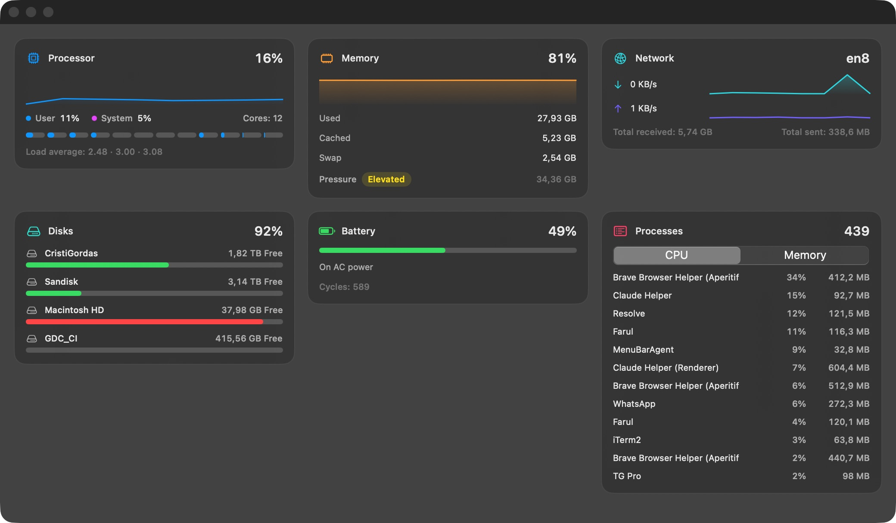

<p align="center"></p>

# Farul

**EN** · [RO](#ro) · [ES](#es)

Free, lightweight system monitor for the macOS menu bar: CPU, memory, network, disks, battery and top processes. Native SwiftUI, one shared sampler, no account, no telemetry, no ads.

- **Download:** https://github.com/gordasgdc/farul/releases/latest (double-click the `.pkg`) · Site: https://gordas.dev/farul/
- **Requires:** macOS 13 or later (Apple Silicon).
- **Languages:** Romanian, English, Spanish (follows the system, switchable in Settings).
- **Privacy:** everything stays on your Mac. Update checks only fetch a small manifest; installers are verified (SHA-256 + developer signature) before install, with automatic rollback.

## Build
```bash
cd macOS/Farul && swift build -c release
```
Packaging and signing (`scripts/build_app.sh`) need your own Developer ID certificates and a work folder: `export FARUL_WORK=/path/to/work`. Tests: `scripts/test.sh`, `scripts/check-l10n.sh`.

## Contribute
Issues and pull requests are welcome. Every visible text goes through `L.t(...)` in `Localization.swift` in all three languages; run `scripts/check-l10n.sh` before opening a PR.

## License
MIT — © 2026 Dumitru Cristinel Gordas (GDC). See [LICENSE](LICENSE) and [NOTICE](NOTICE) (no third-party code).

---

## RO
Monitor de sistem gratuit și ușor pentru bara de meniu macOS: procesor, memorie, rețea, discuri, baterie și procesele active. SwiftUI nativ, un singur eșantionator, fără cont, fără telemetrie, fără reclame.

- **Descărcare:** https://github.com/gordasgdc/farul/releases/latest (dublu-clic pe `.pkg`) · Site: https://gordas.dev/farul/
- **Cerințe:** macOS 13 sau mai nou. **Limbi:** română, engleză, spaniolă.
- **Confidențialitate:** totul rămâne pe Mac-ul tău; actualizările sunt verificate (SHA-256 + semnătură) înainte de instalare, cu revenire automată.
- **Compilare:** `cd macOS/Farul && swift build -c release`. **Contribuții:** bine venite; textele trec prin `L.t(...)`, rulează `scripts/check-l10n.sh`.
- **Licență:** MIT — © 2026 Dumitru Cristinel Gordas (GDC).

## ES
Monitor de sistema gratuito y ligero para la barra de menús de macOS: procesador, memoria, red, discos, batería y procesos activos. SwiftUI nativo, un único muestreador, sin cuenta, sin telemetría, sin anuncios.

- **Descarga:** https://github.com/gordasgdc/farul/releases/latest (doble clic en el `.pkg`) · Web: https://gordas.dev/farul/
- **Requisitos:** macOS 13 o posterior. **Idiomas:** rumano, inglés, español.
- **Privacidad:** todo queda en tu Mac; las actualizaciones se verifican (SHA-256 + firma) antes de instalar, con reversión automática.
- **Compilar:** `cd macOS/Farul && swift build -c release`. **Contribuir:** bienvenido; los textos pasan por `L.t(...)`, ejecuta `scripts/check-l10n.sh`.
- **Licencia:** MIT — © 2026 Dumitru Cristinel Gordas (GDC).
